<p align="center">
  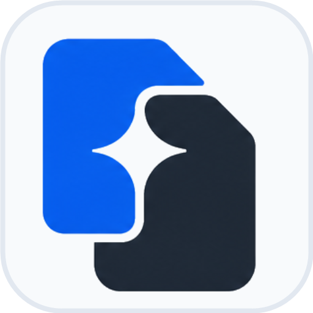
</p>

<h1 align="center">OpenNotebookLM</h1>

<p align="center">
  <b>Your sources. Your research workspace. Your choice of model.</b><br>
  A self-hosted alternative to Google NotebookLM for reading, asking questions,<br>
  and turning source material into notes, reports, mind maps, audio, and slides.
</p>

<p align="center">
  <a href="LICENSE"></a>
  
  
  
  
</p>

<p align="center">
  <a href="#quick-start">Quick start</a> ·
  <a href="#features">Features</a> ·
  <a href="#screenshots">Screenshots</a> ·
  <a href="#configuration">Configuration</a> ·
  <a href="#development">Development</a>
</p>

<p align="center">
  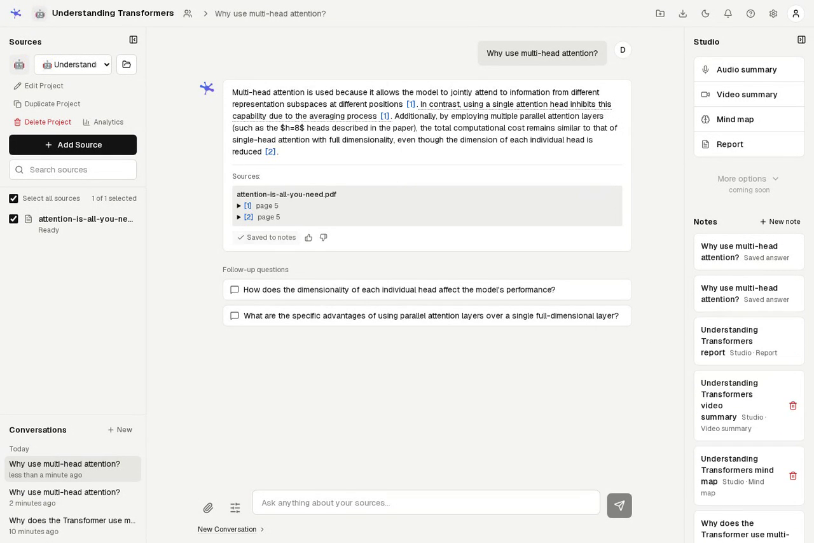
</p>

Import a paper, a spreadsheet, a recording, or a set of links. Ask questions
against the sources you select, inspect the passages behind each answer, and
save useful results alongside your research. Share a project with other accounts
when you want to work together.

Documents, extracted text, embeddings, conversations, and notes are stored on
your server. Extraction, OCR, embeddings, speech recognition, and Kokoro audio
overview synthesis run locally. When you choose a remote LLM, prompts and source
excerpts used for generation are sent to that provider. A local LLM keeps text
generation on your infrastructure. Slide narration and the browser-speech audio
fallback use browser or operating-system voices, which may use a remote speech
service. Initial model downloads and web imports also need network access.

## Demo

<p align="center">
  <a href=".github/assets/demo.mp4">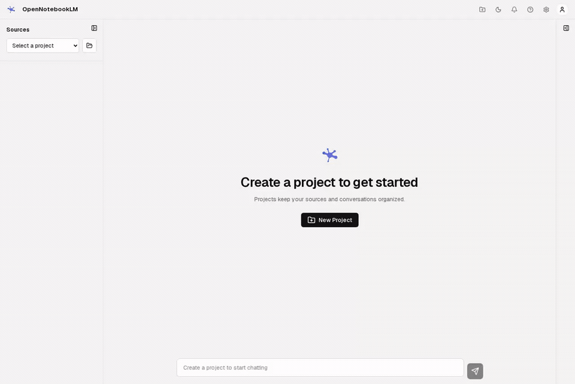</a>
</p>

[Watch the 29-second walkthrough (MP4, silent)](.github/assets/demo.mp4).

<!--
Media restored 2026-10-26 from the original recording of revision 08c63ac,
with only its project-cover emoji updated to 🤖. The recording uses
an isolated database and the public Attention Is All You Need PDF. Generation used
qwen/qwen3.8-27b through the configured OpenAI-compatible provider; local
embeddings used BAAI/bge-small-en-v1.5, an override for this English-only capture.
Responses and Studio outputs are generated by the application; no API responses
or interface content are mocked. The GIF is a sped-up preview of the recorded
browser walkthrough, which opens previously generated Studio results.
Only the project-cover emoji has been replaced in the original media.
Retake the media when the workspace or the demonstrated behavior changes.
-->

## Features

| Workflow | What you can do |
| --- | --- |
| **Collect sources** | Upload documents, images, or audio; import web pages, PDF URLs, YouTube videos or playlists, Markdown folders, Obsidian vaults, and Git repositories; paste text directly into a project. |
| **Ask and verify** | Stream answers, ask follow-up questions, choose sources, and open inline citations at their supporting passage. Potentially unsupported citations are flagged for review. Math expressions render in chat and Markdown. |
| **Explore a project** | Get an overview, suggested questions, and guides for individual sources. Set the chat role, custom instructions, answer length, and output language. |
| **Keep useful work** | Write and edit notes, save cited answers and Studio outputs, and convert notes into searchable sources. Export individual or all notes as Markdown, PDF, or DOCX. |
| **Create with Studio** | Generate cited reports in briefing, study guide, FAQ, timeline, or custom formats; mind maps; two-host audio; narrated slides; and tables with cited cells. Customize focus, audience, and length. |
| **Practice what you read** | Generate flashcards and quizzes from selected sources. Mark cards for review, resume saved progress, and run timed quiz rounds with score history. |
| **Export results** | Export conversations as Markdown, JSON, or text; projects as Markdown or JSON; mind maps as Markdown, SVG, or PNG; slides as PowerPoint; tables as CSV; flashcards as CSV or Anki-compatible text; quizzes as CSV or Markdown. Audio is stored as MP3. |
| **Organize and collaborate** | Tag projects, group sources, choose a cover, duplicate or merge projects, inspect usage analytics, and grant viewer or editor access. Restore deleted projects, sources, and notes from Trash during the retention period. |
| **Find and refresh material** | Search source passages across accessible projects, including notes converted into sources. Re-sync URL and YouTube sources, watch a server folder, or discover web sources through an optional search provider. |
| **Choose your model** | Use Claude, OpenAI, another OpenAI-compatible provider, or a local server such as Ollama. Select configured models per project or question. An extractive fallback works without a responding LLM. |
| **Automate and administer** | Create personal API keys for scripts. Configured administrators can inspect server-wide usage and estimated costs. |
| **Work across devices** | Use light or dark mode, collapse workspace panels, and open sources and Studio in drawers on smaller screens. |

### Supported sources

| Source | Formats and behavior |
| --- | --- |
| Documents | `.pdf`, `.docx`, `.pptx`, `.xlsx`, `.epub`, `.txt`, `.md` |
| Images | `.png`, `.jpg`, `.jpeg`, `.webp`; local OCR also handles scanned PDF pages |
| Audio | `.mp3`, `.m4a`, `.wav`, `.ogg`, `.webm`, `.flac`; transcribed locally with Whisper |
| Web | Web pages and direct PDF links; imports are subject to download and redirect limits |
| YouTube | Single videos, playlists, or batches of URLs; transcripts first, with local Whisper fallback when captions are unavailable |
| Pasted text | Add a title and text directly from the Add Source dialog |
| Local folders | Markdown folders and Obsidian vaults through the watched server-folder workflow; vault import records frontmatter and wiki-link metadata |
| Git repositories | Bounded imports of supported repository files, with repository and revision metadata |
| Watched folders | Periodic imports from an administrator-approved server directory; originals stay in place |

Uploads are limited to **50 MB per file** by default. URL downloads default to
**10 MB**, and audio uploads and YouTube transcription default to **30 minutes**.
Limits and enabled formats are configurable. Source processing runs in a durable
background queue, with progress and failures shown in the workspace.

## Screenshots

The screenshots and demo use an imported copy of
[*Attention Is All You Need*](https://arxiv.org/abs/1706.03762), with answers and
derived materials generated by the application.

### Add sources in one place

Upload files, import links or YouTube videos, and paste text without leaving the
project. Select sources in the sidebar to control the evidence used by chat and
Studio.

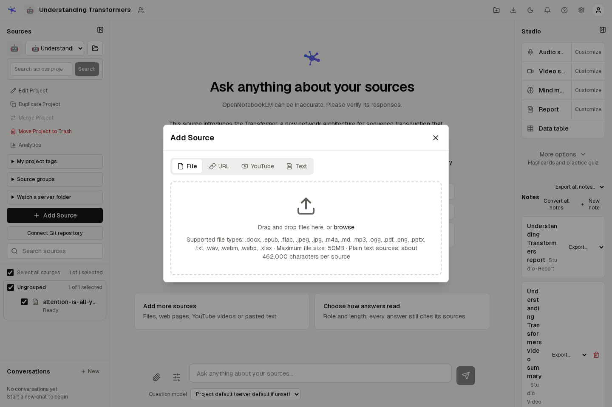

### Check the evidence behind an answer

Hover over a numbered citation to inspect the passage and its page. Save an
answer to a note to keep the response and its source references together.

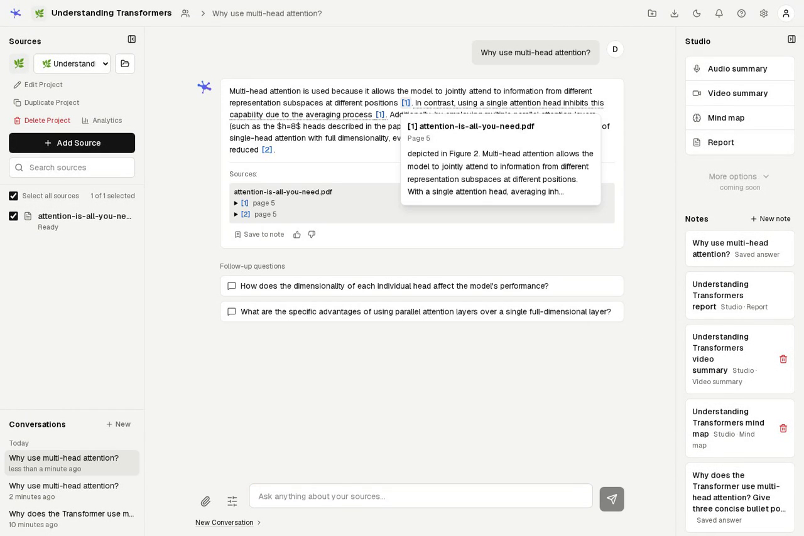

### Turn an idea into a mind map

Expand or collapse branches, pan and zoom, inspect concepts, and prepare a
question with **Ask in chat**. Download the map as Markdown or save it to notes.

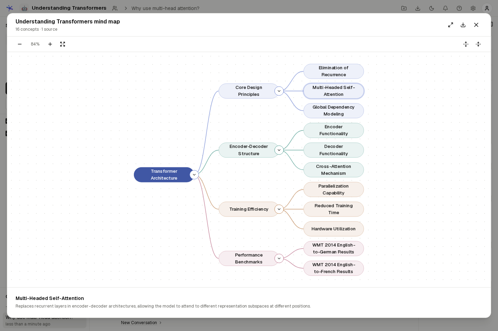

### Listen to a two-host overview

Choose **Deep dive**, **Brief**, **Critique**, or **Debate**, set the length, and
optionally focus the hosts on a question. Audio generation runs in the background;
completed overviews retain their transcript and player.

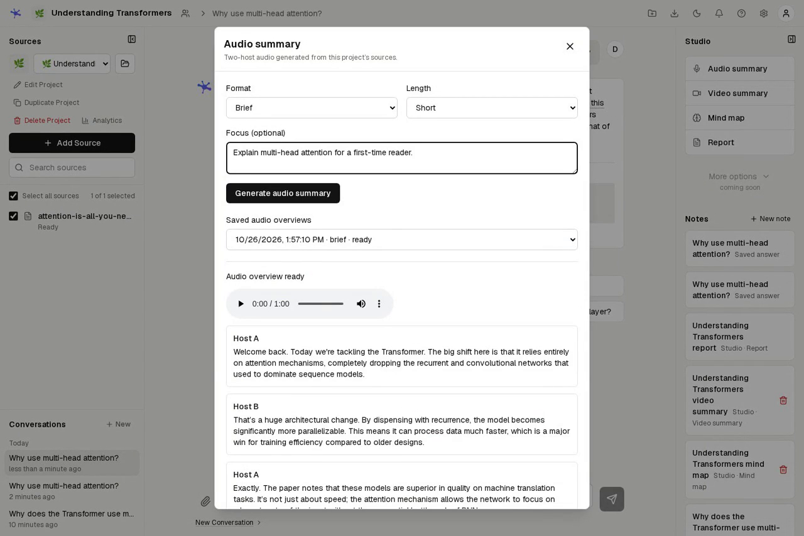

### Present the material as slides

Play a narrated walkthrough, move between scenes, and export the displayed
summary as `.pptx` or a Markdown script. Save it to notes to revisit the same
result later.

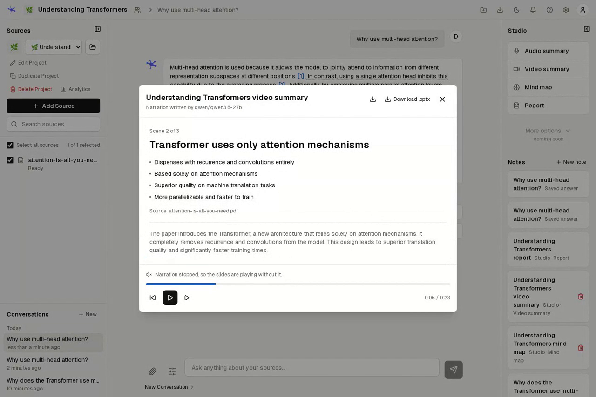

### Keep results in the workspace

Save cited answers, generated reports, and other Studio outputs to Notes
alongside your own writing. Reopen saved results or turn notes into sources for
later questions. Switch between light and dark themes from the top bar.

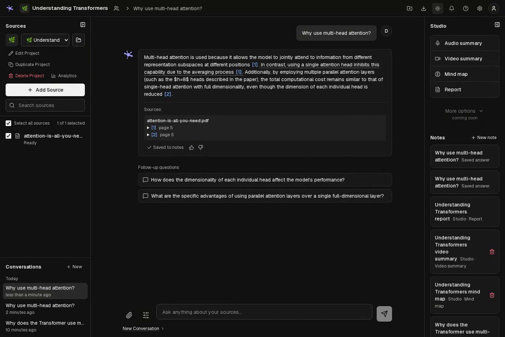

### Share a project with clear permissions

Add an existing account by username or email. Viewers can read sources and notes,
ask questions, and use Studio; editors can also manage sources, notes, and chat
settings. The owner controls project settings and membership. Each person's
conversations remain private to that person.

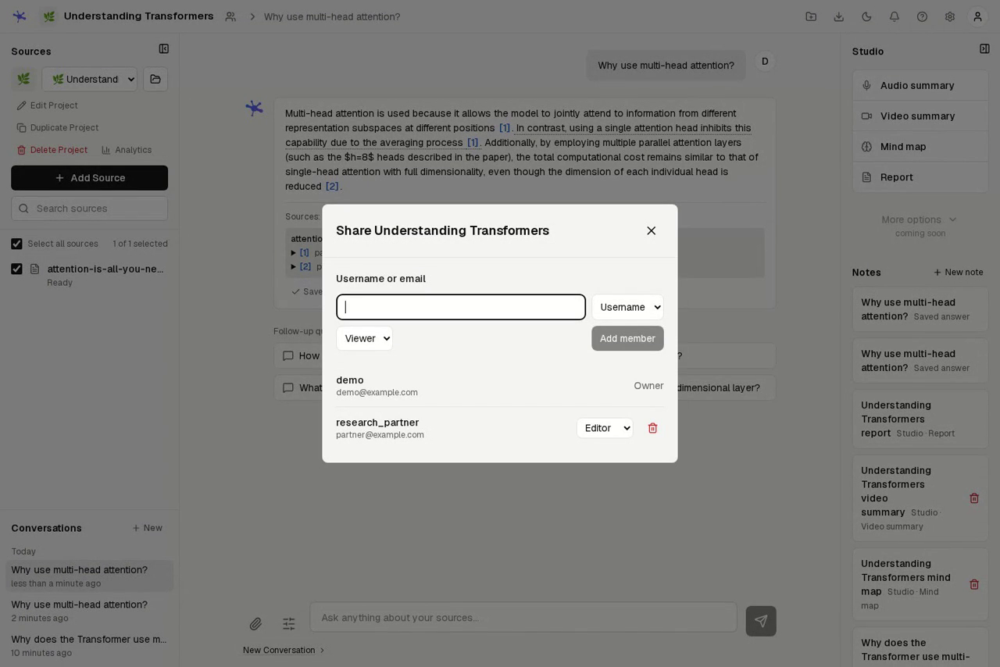

## Quick start

Use Docker Engine 25+ and Docker Compose 2.20.2+ for the supplied stack. Allow
several gigabytes of RAM and disk for the backend and downloaded models.

```bash
git clone https://github.com/tom1030507/OpenNotebookLM.git
cd OpenNotebookLM
cp .env.example .env
```

Edit `.env` before starting:

1. Set `JWT_SECRET_KEY` to a unique random value. You can generate one with
   `python -c "import secrets; print(secrets.token_urlsafe(32))"`.
2. Configure an LLM provider using the examples below, or set `LLM_MODE=none` to
   try source import and extractive answers without a model server or API key.

```bash
docker compose up -d --build
docker compose ps
```

| Service | Address |
| --- | --- |
| Workspace | <http://localhost:3000> |
| API documentation | <http://localhost:8000/docs> |
| Liveness | <http://localhost:8000/healthz> |
| Database readiness | <http://localhost:8000/readyz> |

For a local trial, the sign-in page offers **demo / demo1234** by default.
Create a project, choose **Add Source**, wait for the source to become **Ready**,
and ask your first question. Models download on first use, so the first import,
OCR request, transcription, or audio overview can take longer.

> [!IMPORTANT]
> Set `SEED_DEMO_USER=false` before making the deployment accessible to others,
> and [create your own account](#accounts-and-sharing). The demo credentials are
> published on the sign-in page. Public registration is closed by default in
> Docker Compose.

> [!NOTE]
> Without a working LLM, chat returns extracted source text and the API reports
> `model_used: "fallback"`. This is useful for testing retrieval, but it is not a
> generated explanation. Generated project overviews and suggested questions
> require a working provider.

Stop the stack with `docker compose down`. Its named volumes retain your data.
**`docker compose down --volumes` deletes those volumes.**

## Configuration

The annotated [`.env.example`](.env.example) lists backend settings;
[`backend/app/config.py`](backend/app/config.py) defines their defaults and
validation. [`docker-compose.yml`](docker-compose.yml) shows which settings the
container receives. A setting used when running Python directly may need to be
added to the Compose service's `environment` block when running in Docker.

### LLM providers

Set one of the following in `.env`. Use a model ID available to your account or
local server. With `LLM_MODE=auto`, provider selection prefers Claude, then an
OpenAI-compatible provider, then a local server. Pin the mode when you want a
specific provider.

<details>
<summary><b>OpenAI or an OpenAI-compatible provider</b></summary>

```dotenv
LLM_MODE=openai
OPENAI_API_KEY=your-api-key
OPENAI_MODEL=your-model-id
OPENAI_BASE_URL=
```

Leave `OPENAI_BASE_URL` empty for OpenAI itself, or set it to the provider's
OpenAI-compatible base URL. The backend uses the chat-completions API. Request
parameter support varies by provider and model; compatibility with that API is
required.

`OPENAI_MIN_MAX_TOKENS` sets a floor for the output budget. Set
`LLM_MAX_OUTPUT_TOKENS` or `LLM_MAX_REQUEST_TOKENS` if your provider needs explicit
output or total-request limits. `OPENAI_REASONING_FORMAT` is a provider-specific
extension; leave it empty unless your provider supports it.

</details>

<details>
<summary><b>Claude</b></summary>

```dotenv
LLM_MODE=claude
CLAUDE_API_KEY=your-api-key
CLAUDE_MODEL=your-model-id
```

The Claude path uses Anthropic's Messages API. `CLAUDE_EFFORT` and the Claude
output-budget settings are available in the backend configuration; add them to
Compose's `environment` block if you need to override them there.

</details>

<details>
<summary><b>Local generation with Ollama</b></summary>

For the bundled Compose service:

```dotenv
LLM_MODE=local
OLLAMA_BASE_URL=http://ollama:11434/v1
OLLAMA_MODEL=llama3.2
```

```bash
docker compose --profile with-ollama up -d --build
docker compose exec ollama ollama pull llama3.2
```

The bundled Ollama service requests an NVIDIA GPU. On a CPU-only machine, remove
its GPU reservation in a local Compose override, or run Ollama separately and
point `OLLAMA_BASE_URL` at an address reachable from the backend container.
Inside a container, `localhost` refers to that container.

Other local OpenAI-compatible servers, including llama.cpp and vLLM, can use the
same settings. Include the `/v1` path and use the model name the server exposes.
After the required models are cached, local files and local generation can be
used without contacting a cloud LLM.

</details>

<details>
<summary><b>No LLM provider</b></summary>

```dotenv
LLM_MODE=none
```

Imports, embeddings, retrieval, and extractive chat answers still work. Mind maps
and slide summaries can derive fallback content from the sources. Output quality
and feature availability differ from a run with a configured model.

</details>

Apply environment changes with `docker compose up -d`. Rebuild the frontend after
changing `BACKEND_INTERNAL_URL` or `MAX_FILE_SIZE_MB`; its API rewrites and request
buffer limit are set at build time. Browser requests use the same-origin `/api`
path, which Next.js proxies to the backend.

### Accounts and sharing

Create an account without enabling public registration. The command prompts for
a password without echoing it:

```bash
docker compose exec backend python -m scripts.create_user \
  --username operator --email operator@example.com
```

To allow self-registration, set `ALLOW_PUBLIC_REGISTRATION=true`. To disable the
demo account on startup, set `SEED_DEMO_USER=false`; this stops automatic seeding
and advertising, but does not remove an account already in the database.
Changing `DEMO_PASSWORD` also does not rotate an existing account's password.
If a demo account was already seeded, disable or remove that account in the
database as well before exposing the deployment to others.

Create personal API keys in **Settings → API Keys** for scripts and automation.
Copy each key when it is shown; the server stores only its hash. Send it as
`Authorization: Bearer onlm_your_key`. Keys inherit the account's data access and
rate limits; creating or revoking keys requires a login session.

Use the share button beside the project title to add existing users as viewers
or editors. Access is checked by the backend on every protected operation;
unavailable or inaccessible resources return `404`. Shared projects expose
sources and notes to their members, while conversations remain private.

For a deployment reachable over the network, put HTTPS in front of the app,
configure the intended frontend origins with `CORS_ORIGINS`, and restrict the
published ports as appropriate for your host.

Set `ADMIN_EMAILS` to a comma-separated list of account email addresses to grant
access to the server usage overview. Cost totals are estimates controlled by
`ESTIMATED_COST_PER_1K_TOKENS_USD`.

### Source discovery and watched folders

Source discovery is optional. Set `SEARCH_PROVIDER` to `searxng`, `brave`, or
`tavily` and supply the matching `SEARXNG_URL`, `BRAVE_SEARCH_API_KEY`, or
`TAVILY_API_KEY`. With the default `none`, ordinary imports and project search
still work; discovering new web sources is unavailable.

Compose mounts `./watched-folders` read-only at `/app/watched-folders`. Set
`WATCHED_FOLDER_HOST_PATH` in `.env` to use a different host directory, recreate
the backend, and open **Sources → Watch a server folder** in an owned project.
Enter a path inside the mounted root. The backend scans every minute, copies
supported files into its upload store, and removes deleted files from search
without deleting the originals. For a backend outside Docker, set
`WATCHED_FOLDER_ROOT` to the permitted local directory.

### Storage and upgrades

| Docker volume | Contents |
| --- | --- |
| `opennotebooklm-data` | SQLite database: projects, accounts, text, chunks, embeddings, conversations, notes, and job metadata |
| `opennotebooklm-uploads` | Uploaded files and generated audio |
| `opennotebooklm-models` | Downloaded embedding, OCR, transcription, and TTS models |
| `opennotebooklm-ollama-models` | Models used by the optional Ollama service |

Back up the database and uploads together before upgrading or reindexing. Stop
the backend while taking a filesystem copy of SQLite so the copy is consistent.
Model caches can be downloaded again.

Deleted projects, sources, and notes are retained in Trash for
`TRASH_RETENTION_DAYS` (30 days by default), where they can be restored or
permanently removed. Trash is a recovery window, not a backup.

<details>
<summary><b>Migrating older installations that used local bind mounts</b></summary>

Older releases used `./data`, `./uploads`, and `./models` on the host. Stop the
old stack and back up those directories first. Before starting the new stack
with empty named volumes, set `JWT_SECRET_KEY` and migrate the durable state:

```bash
docker compose build backend
docker compose create backend
docker cp data/opennotebook.db opennotebook-backend:/app/data/opennotebook.db
docker cp uploads/. opennotebook-backend:/app/uploads/
docker compose run --rm --no-deps --user root backend \
  sh -c 'chown -R 1000:1000 /app/data /app/uploads'
docker compose rm -f backend
docker compose up -d
```

Skip a copy command if its old path does not exist. Copy only the database and
uploads; `data/redis` and `models/ollama` are caches rather than backend user data.
Keep the old directories until you verify the migrated projects and sources.

</details>

Older databases may contain projects or documents without an owner. These rows
stay hidden until assigned to an account:

```bash
docker compose exec backend python -m scripts.assign_owner \
  --username operator --dry-run
```

Review the result, then remove `--dry-run` to assign the unowned rows. The script
does not transfer rows that already have an owner.

### Embeddings

The default embedding model is `intfloat/multilingual-e5-base` with 768 dimensions.
Retrieval combines a persistent sqlite-vec dense index with FTS5/BM25 keyword
search, including CJK bigrams, and fuses the candidates before building the prompt.

Changing `EMB_MODEL_NAME` requires regenerating stored embeddings. Back up first,
update `.env`, recreate the backend, and rebuild in place:

```bash
docker compose up -d backend
docker compose exec backend python -m scripts.reindex --dry-run
docker compose exec backend python -m scripts.reindex
```

Reindexing keeps document IDs and project associations. It re-extracts sources,
rebuilds chunks and embeddings, and reconciles the persistent indexes. A source
that can no longer be read is marked as an error. Use `--index-only` to repair
candidate indexes from existing chunks and embeddings; it does not regenerate
vectors after an embedding-model change.

### Optional Redis cache

```bash
docker compose --profile with-cache up -d
```

Without Redis, the backend uses a bounded per-process memory cache. The bundled
Redis service is internal to the Compose network, capped at 256 MB by default,
and disposable: restarting it clears the cache. `CACHE_MAX_ENTRIES` and
`REDIS_MAXMEMORY` control the respective limits.

## How it works

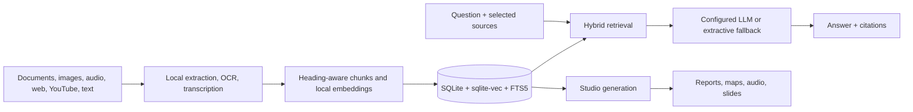

The Next.js frontend calls FastAPI through its `/api` proxy. Projects, membership,
sources, conversations, and notes share the same authenticated API. Ingestion
and audio overview jobs run in background workers and persist their state in
SQLite.

For API exploration, use [Swagger UI](http://localhost:8000/docs) or
[`/openapi.json`](http://localhost:8000/openapi.json) on your running instance.
Sign in at `POST /api/auth/token` and send the returned token as
`Authorization: Bearer <token>` for protected routes. The schema is the source of
truth for request bodies and endpoints.

## Development

The live application is under `backend/app/` and `frontend/`. See
[AGENTS.md](AGENTS.md) for repository conventions.

```text
backend/app/       FastAPI routes, services, importers, and database models
backend/scripts/   Account bootstrap, ownership backfill, reindexing, evaluation
backend/tests/     API, lifecycle, unit, and retrieval evaluation tests
frontend/app/      Next.js routes and global styles
frontend/components/, hooks/, lib/, store/
                   Workspace UI, browser behavior, API client, and state
e2e/               Playwright browser workflows
deploy/            Compatibility Compose entry point
.github/assets/    README screenshots and demo recordings
```

### Run locally

Use Python 3.11 and Node.js 20+; the browser test package requires Node.js 22+.
The backend needs the ML dependencies in its requirements file and system tools
including `ffmpeg` and `espeak-ng` for the relevant audio features. Docker provides
these dependencies for you.

```bash
cd backend
python -m venv venv
source venv/bin/activate
# Windows PowerShell: .\venv\Scripts\Activate.ps1
pip install -r requirements.txt
cp ../.env.example .env
# Configure .env for this backend process.
python -m uvicorn app.main:app --reload --port 8000
```

In a second terminal:

```bash
cd frontend
npm ci
npm run dev
```

A local backend reads `backend/.env` and stores its database and uploads under
`backend/` by default. The root `.env` configures Compose. Local development uses
`http://localhost:8000` as the frontend's default backend destination.

### Checks

```bash
# Frontend
npm --prefix frontend test
npm --prefix frontend run lint
npm --prefix frontend run typecheck
npm --prefix frontend run build

# Backend, with the full dependency stack installed
cd backend
python -m pytest tests -q
```

The backend suite imports PyTorch and sentence-transformers during collection;
a minimal Python environment is insufficient. Use the backend image when those
dependencies are unavailable locally. Configuration tests also need the
repository's `.env.example` and Compose files available above `backend/`.

For isolated browser tests from the repository root:

```bash
python -m pip install -r backend/requirements-e2e.txt
npm --prefix frontend ci
npm --prefix e2e ci
npx --prefix e2e playwright install chromium
npm --prefix e2e test
```

The fast browser suite uses isolated services on ports 3100 and 8100, local test
data, and no LLM key. See [the E2E guide](e2e/README.md) for runtime isolation,
retained failure artifacts, `E2E_PYTHON`, and the optional production-embedding
suite.

Measure retrieval changes with the existing evaluation corpus:

```bash
cd backend
LLM_MODE=none python -m scripts.eval_retrieval \
  --tag baseline --out ../output/rag-eval
```

The evaluator uses its own database and reports Recall@k and MRR. Keep generated
evaluation artifacts under the gitignored `output/` directory.

## Current limits

- **Generated content needs review.** Citations and support checks help inspect
  evidence; they do not guarantee that an answer is correct. Cross-language
  retrieval can miss passages when the question and source share little vocabulary.
- **Video summary means a narrated slideshow.** Studio exports a Markdown script
  or PowerPoint deck, rather than a rendered MP4. Narration depends on the
  browser's speech support. The README's demo MP4 is a separate screen recording.
- **Audio overviews use English Kokoro voices.** Script quality depends on the
  selected LLM, and model loading can delay the first generation. If local TTS is
  disabled, Audio summary uses browser speech where supported.
- **YouTube imports depend on upstream availability.** Captions, metadata, and
  downloads can be blocked or rate-limited. Whisper fallback is bounded by the
  configured duration limit and can be slow on a CPU.
- **Studio operates on bounded source excerpts.** Large projects may be only
  partially represented in generated outputs; mind maps report their coverage.
- **Provider delays affect generation.** Rate-limit retries can outlast the
  frontend proxy's waiting period. Check backend logs if an output fails after
  a long wait.
- **sqlite-vec uses exact vector search.** Persistent indexes reduce application
  overhead, but this is not an ANN index for arbitrarily large collections.
- **Some controls are still marked “coming soon.”** Those controls are disabled;
  they are not included as available features above.

## Contributing

Open an issue for a bug or feature proposal, or submit a focused pull request.
Include a reproducible example, the checks you actually ran, and screenshots for
visible UI changes. Keep credentials, databases, uploads, and model files out of
commits. Development conventions and test guidance are in [AGENTS.md](AGENTS.md).

When updating README media, capture the real application with public or synthetic
sources and an isolated database. Include the relevant workflow and controls,
avoid exposing personal data, and update the recording when the interface changes.
Store final media in `.github/assets/` and temporary captures in `output/`.

## License

[MIT](LICENSE). OpenNotebookLM is an independent project and is not affiliated
with Google.
